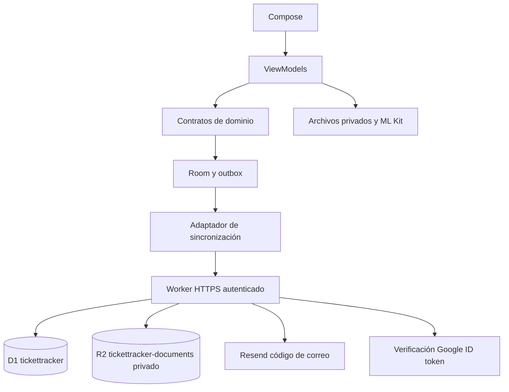

# Arquitectura

Compose observa Room mediante Flow. Los ViewModels usan contratos de dominio y estados UDF. El dominio no importa Android ni proveedores cloud. Hilt enlaza adaptadores en `app/di`. El proceso de importación, OCR, hashing, exportación y red se ejecuta fuera del hilo principal.

`AccountGateway`, `IdentityGateway`, `PurchaseRepository`, `DocumentStore` y `SyncController` separan presentación, dominio y proveedores. `CloudSessionStore` cifra la sesión con AES-GCM y Android Keystore. Al acceder, adopta transaccionalmente el inventario anónimo; un marcador cifrado permite repetir la adopción tras un cierre inesperado. Una cuenta distinta no ve los registros de otra.

WorkManager sincroniza con red disponible, backoff y revisión periódica de seis horas. El botón de Perfil permite solicitar una ejecución inmediata. Los conflictos se conservan en Room y requieren una elección explícita. Una respuesta antigua solo confirma su operationId y deja una edición posterior en cola.

Las pantallas funcionan sin API configurada. Configurar los identificadores públicos de API/OAuth habilita el acceso; nunca se simulan cuentas ni datos remotos. Los documentos se descargan al abrir, comprobando su hash. No hay expulsión de originales. Android excluye estos datos de sus backups automáticos; el ZIP explícito aún no tiene restaurador.

Decisión vigente: ADR 0002. El despliegue real y la recuperación entre instalaciones requieren validación aparte de las pruebas locales.
